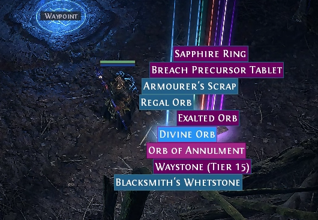

# PixxelFilter

A personal Path of Exile loot filter and a working example of [PoeFilterX](https://github.com/SteffenBlake/PoeFilterX), with category-based matching, shared styles, and poe.ninja price tiers.



## Install

1. Download applicable `.filter` files under **Assets** on the [latest release](https://github.com/SteffenBlake/pixxel-filter/releases/latest). Choose normal, strict, or max; see [Strictness profiles](#strictness-profiles) below.
2. In Path of Exile, open **Options → Game** and click the folder button next to the item-filter dropdown. Copy the downloaded file into that folder.
3. Select the filter from the dropdown. If you're replacing an existing filter file, click the reload button.

## Build

Install the [.NET 11 SDK and PoeFilterX CLI](https://github.com/SteffenBlake/PoeFilterX/wiki/Installation).

From the repository root, run:

```sh
dotnet run --file build.cs
```

[`build.cs`](build.cs) refreshes the poe.ninja JSON cache, then builds all three PoE1 profiles through `poefilterx build --profile`. It stops if the cache script or a build fails.

By default, the files are written to the repository root:

- `poe1-normal.filter`
- `poe1-strict.filter`
- `poe1-max.filter`

Copy the desired filter to your game's item-filter folder, then select it in the game's item-filter settings. You can also configure the build to write directly to that folder.

### Output directories

Copy [`environment.example.json`](environment.example.json) to `environment.json` and edit the paths:

```json
{
  "Poe1": ".",
  "Poe2": "."
}
```

## Strictness profiles

All three profiles share the same category rules. Stylesheets control which tiers are shown.

| Profile | Visible value tiers | Output |
| --- | --- | --- |
| `poe1-normal` | Junk and above | `poe1-normal.filter` |
| `poe1-strict` | Useful and above | `poe1-strict.filter` |
| `poe1-max` | Valuable and above | `poe1-max.filter` |

## Price tiers and stacks

The cache script assigns supported items to tiers using these inclusive lower bounds, expressed in Chaos Orbs:

| Tier | Minimum Chaos value |
| --- | ---: |
| `junk-tier` | 0 |
| `common-tier` | 0.1 |
| `useful-tier` | 1 |
| `valuable-tier` | 5 |
| `premium-tier` | 15 |
| `exceptional-tier` | 50 |
| `divine-tier` | 100 |
| `mirror-tier` | 1,000 |

### Price cache and individual builds

The cache defaults to the first active PoE1 economy league. It reuses responses for six hours and conditionally revalidates expired responses using ETags. A first build needs internet access to fetch prices.

To refresh the data and build a single profile manually, run from the repository root:

```sh
dotnet run --file src/ninja-cache.cs
```
